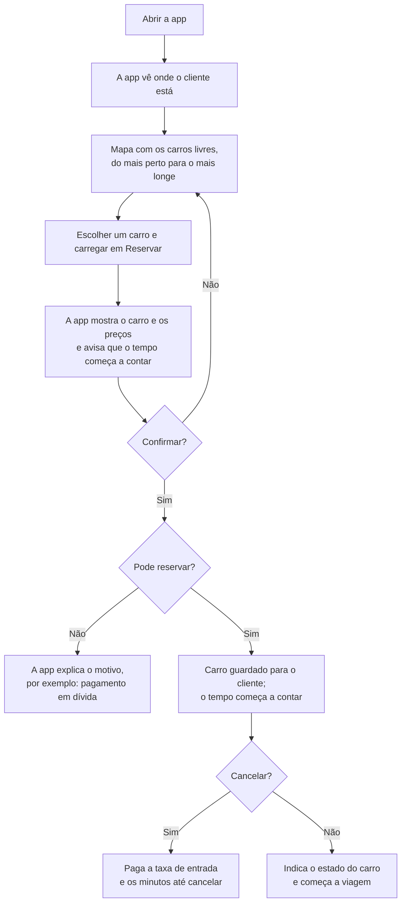

# Como funciona a DriveNow

Explicação, sem linguagem técnica, das funcionalidades básicas da DriveNow. O detalhe técnico está no diagrama de arquitetura (`doc/Arquitetura/Arquitetura DriveNow V3.png`) e nos diagramas 1 a 7 (`doc/Diagramas/`).

A DriveNow é um serviço de partilha de carros elétricos em Guimarães. O cliente encontra um carro perto de si na app, reserva-o, conduz e deixa-o onde termina a viagem. Paga uma taxa de entrada, os minutos e os quilómetros que fez, e recebe a fatura por email. Os carros vão à oficina da DriveNow a cada 15 000 km.

## As peças do sistema

| Peça | Nome no projeto | O que faz |
|---|---|---|
| A app | App DriveNow (React) | É o que o cliente usa no telemóvel ou no computador: criar conta, ver o mapa, reservar, conduzir, pagar e ver as viagens e as faturas. Não guarda dados. |
| A central da DriveNow | Backend (Spring Boot) | É o "cérebro": decide se o cliente pode reservar, conta o tempo e os km, calcula o preço e decide quem paga um dano. Guarda as reservas, as viagens, os trajetos, os pagamentos e a posição dos carros. |
| A gestão da frota e da oficina | Odoo | É onde a empresa gere os carros: a lista de carros, os preços de cada modelo, os km e as revisões, os danos e as reparações, o seguro, a inspeção e o IUC. Também vai gerir o armazém da oficina: as peças em stock e as compras aos fornecedores. |
| A ficha de clientes | SAP | Guarda a ficha de cada cliente da empresa. |
| A faturação | Moloni | Emite as faturas, com o NIF do cliente. Está em pausa até a série de faturas estar registada nas Finanças (AT). |
| O serviço de rotas | OSRM (público, com dados do OpenStreetMap) | Diz qual é o percurso pelas ruas entre dois pontos. Serve para desenhar o trajeto de cada viagem. |
| O mensageiro | n8n | Quando algo acontece (cliente registado, viagem terminada, viagem paga, dano reportado), leva a informação aos outros sistemas. Também verifica todos os dias os documentos dos carros. |

A app só fala com a central. A central consulta a gestão da frota diretamente e usa o mensageiro para tudo o resto. Assim, se um sistema estiver em baixo (por exemplo, a faturação ou o serviço de rotas), o cliente continua a conseguir reservar e terminar a viagem.

## 1. Criar conta

1. O cliente abre a app e escolhe "Criar conta".
2. Preenche o nome, o email, o NIF, o telemóvel e a palavra-passe, associa um cartão ou uma conta bancária e aceita os termos.
3. A central confirma que os dados estão certos (por exemplo, que o NIF é válido). Se algo estiver errado, a app pede para corrigir.
4. A conta fica ativa e a app abre logo o mapa.
5. Em segundo plano, o mensageiro cria a ficha do cliente no SAP (e no Moloni, quando voltar), para que as faturas saiam com os dados certos.

Do cartão só se guardam os últimos 4 dígitos. Sem meio de pagamento não é possível reservar.

## 2. Como se reserva um carro

1. **Encontrar um carro.** Com autorização do cliente, a app vê onde ele está (GPS) e mostra no mapa os carros livres, do mais perto para o mais longe. Para cada carro mostra a distância, a taxa de entrada, o preço por minuto e o preço por km.
2. **Carros que não aparecem.** Não aparecem os carros:
    - já reservados por outra pessoa;
    - em reparação;
    - com a revisão por fazer (ponto 8);
    - com o seguro, a inspeção ou o IUC caducados.

    Se não houver nenhum carro livre, o mapa vai-se atualizando.
3. **Confirmar.** O cliente escolhe o carro e carrega em "Reservar". A app mostra os dados do carro (modelo, matrícula, lugares, km) e os preços: taxa de entrada, preço por minuto, preço por km e um exemplo de quanto custa uma viagem de 30 minutos e 10 km. Avisa também que o tempo começa a contar a partir da reserva.
4. **Reservar.** Quando o cliente confirma, a central verifica quatro coisas:
    - o cliente não tem outra reserva a decorrer (só uma de cada vez);
    - tem um meio de pagamento associado;
    - não tem pagamentos em dívida;
    - o carro continua livre.

    Se alguma falhar, a reserva não é feita e a app explica porquê (por exemplo, "tem um pagamento em dívida").
5. **Reserva confirmada.** O carro fica guardado para este cliente e desaparece do mapa dos outros. Os preços ficam fixos para esta reserva, mesmo que a tabela mude depois, e a central regista os km que o carro tem nesse momento e onde está. O tempo começa a contar a partir deste momento.
6. **Cancelar.** O cliente pode cancelar antes de começar a viagem. Paga a taxa de entrada e os minutos em que o carro esteve guardado para ele. Não paga km, porque o carro não saiu do sítio.

## 3. A viagem

1. Junto ao carro, o cliente indica na app o estado em que o encontrou: "sem danos", ou o tipo de dano e uma descrição.
2. Desbloqueia o carro e conduz. A app mostra o tempo e o valor até ao momento (os km somam-se no fim).
3. Para terminar, carrega em "Terminar viagem" e indica:
    - outra vez o estado do carro;
    - os km que aparecem no painel do carro, que são obrigatórios;
    - onde deixou o carro, pelo GPS ou tocando no mapa.

    Enquanto escreve os km, a app mostra quantos km fez e quanto custam.
4. A central confirma que os km fazem sentido: não podem ser menos do que os do início, nem dar uma viagem de mais de 1000 km (seria um engano ao escrever). Depois:
    - calcula os km da viagem: km do painel menos os km do início;
    - regista onde o carro ficou;
    - atualiza os km do carro na gestão da frota.
5. **Trajeto.** A central pede ao serviço de rotas o percurso pelas ruas entre onde o carro estava e onde ficou, e o resumo da viagem mostra-o num mapa. É um trajeto simulado: a DriveNow não segue o carro por GPS durante a viagem, e os km cobrados são sempre os do painel. Se o serviço de rotas não responder, o mapa mostra a linha reta entre o início e o fim.
6. O carro volta a aparecer no mapa, no sítio onde ficou, para o próximo cliente. As exceções são:
    - um carro que ficou com um dano que o impede de circular (ponto 6);
    - um carro que chegou aos km da revisão (ponto 8).

## 4. Quanto se paga

**Preço = taxa de entrada + minutos × preço por minuto + km × preço por km + penalizações por danos**

- A taxa de entrada, o preço por minuto e o preço por km dependem do modelo do carro e estão definidos na gestão da frota. O preço por km acompanha a gama do carro: 0,10 € nos mais baratos, 0,15 € na maioria, 0,25 € e 0,40 € nos de gama alta. Os preços já incluem IVA (23%).
- Os minutos contam desde a reserva até ao fim da viagem. Cada minuto começado conta como inteiro.
- Os km são os do painel no fim menos os que o carro tinha quando foi reservado.
- Só há penalizações se o cliente reportar um dano no fim da viagem (ponto 6).

Exemplo: um Renault Zoe tem uma taxa de entrada de 10 €, custa 0,18 € por minuto e 0,10 € por km. Uma viagem de 30 minutos e 10 km, sem danos, custa 10 + 30 × 0,18 + 10 × 0,10 = **16,40 €**.

## 5. Pagamento e fatura

1. No fim da viagem, o valor é cobrado automaticamente no meio de pagamento do cliente. No projeto, o pagamento é simulado com cartões fictícios, porque não se fazem transações reais: um cartão de teste aprova e outro recusa.
2. A app mostra o resumo: a duração, os km, a taxa, o valor do tempo e dos km, o valor sem IVA, o IVA, o total, o meio de pagamento e o trajeto no mapa.
3. Se o pagamento for recusado, fica uma dívida. O cliente não pode fazer novas reservas até atualizar o meio de pagamento no perfil. Nesse momento, a dívida é cobrada outra vez, automaticamente.
4. Depois de pago, o mensageiro pede ao Moloni a fatura-recibo (taxa, minutos, km e danos). A fatura aparece no ecrã "Viagens e faturas" e é enviada por email.
5. Enquanto o Moloni estiver em pausa ou indisponível, a fatura fica "pendente" e é emitida mais tarde, sem o cliente ter de fazer nada.

A venda fica também registada no SAP, quando estiver definido com o docente qual o serviço a usar.

## 6. Danos

**Quando se reportam.** No início da viagem (o cliente encontrou o carro já com um dano) ou no fim (o dano aconteceu durante a viagem). O cliente escolhe o tipo de dano numa lista (por exemplo, risco ligeiro, jante ou pneu) e descreve-o.

**Dano repetido.** Se esse dano já estava registado e ainda não foi reparado, não conta outra vez.

**Quem paga.**

| Quando foi reportado | Quem paga |
|---|---|
| No fim da viagem | O próprio cliente; o valor junta-se ao da viagem. |
| No início da viagem | O cliente anterior, que usou o carro antes. É avisado e cobrado à parte, com uma fatura própria. |
| No início, sem cliente anterior | Ninguém; o dano fica só registado. |

**Quanto se paga.** O custo vem da tabela de danos da gestão da frota. Por viagem, o cliente nunca paga mais do que a franquia de 1000 €.

**Carro parado.** Alguns danos impedem o carro de circular (por exemplo, um pneu). Nesse caso, o carro fica "em reparação" e sai do mapa. As reparações simples fazem-se na oficina da DriveNow, com peças do armazém. As outras vão a uma oficina externa. Quando o gestor de frota marca a reparação como concluída no Odoo, o carro volta ao mapa.

## 7. Documentos dos carros

1. A gestão da frota guarda, para cada carro, o seguro, a inspeção e o IUC, com as datas de validade.
2. Todos os dias, o mensageiro verifica essas datas. Se um documento caduca nos próximos 30 dias, deixa um aviso no carro, no Odoo, para o gestor de frota.
3. Se um documento já caducou, o carro deixa de poder ser reservado. As viagens já em curso terminam normalmente.
4. Quando o gestor renova o documento no Odoo, o carro volta ao mapa sozinho.

## 8. Revisões por km

1. Todos os carros vão à oficina da DriveNow a cada **15 000 km**. Como os carros são elétricos, não há mudanças de óleo. A revisão verifica e troca o que se gasta: pastilhas de travão, filtro do habitáculo, pneus, escovas, líquido de travões e bateria de 12 V.
2. Cada carro tem, na gestão da frota, os "km da próxima revisão". O gestor de frota vê todos os carros numa lista: a laranja os que estão a menos de 1 000 km da revisão e a vermelho os que já lá chegaram.
3. Quando, no fim de uma viagem, o carro chega aos km da revisão:
    - o carro sai do mapa ("Revisão por fazer");
    - é criada uma ordem de revisão para a oficina.

    O cliente que terminou a viagem não é afetado.
4. A oficina faz a revisão e regista as peças que gastou.
5. Quando a oficina marca a ordem como concluída, a próxima revisão passa para daqui a 15 000 km e o carro volta ao mapa sozinho.

## 9. Oficina e peças (em preparação)

1. A oficina da DriveNow tem um armazém com as peças mais usadas, por exemplo pastilhas de travão, filtros, pneus e escovas. Cada peça tem um stock mínimo e um máximo.
2. **Entradas:** as peças entram no armazém quando chegam as compras aos fornecedores.
3. **Saídas:** as peças saem do armazém quando são gastas numa revisão ou numa reparação, ficando registado em que carro.
4. Quando uma peça desce abaixo do stock mínimo, a gestão da frota propõe sozinha uma encomenda ao fornecedor, até ao stock máximo. O gestor confirma a encomenda e, quando as peças chegam, regista a entrada.

O detalhe das peças, dos mínimos e dos fornecedores está em `doc/Oficina, revisões e peças.md`.
