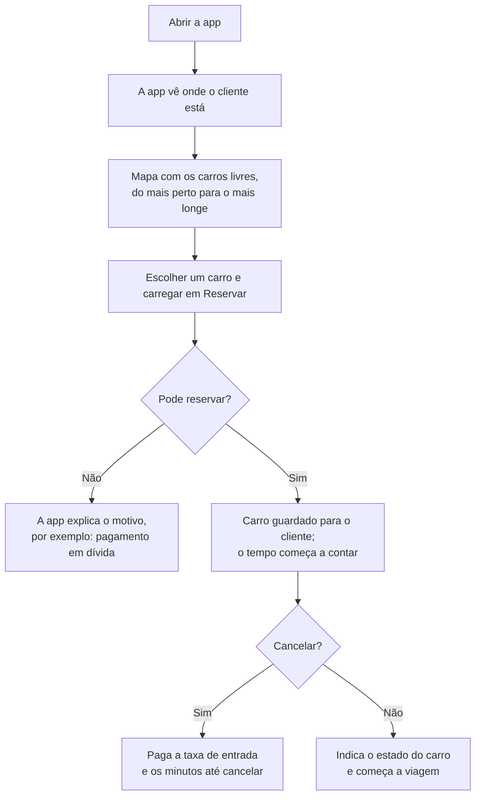

# Como funciona a DriveNow

Explicação, sem linguagem técnica, das funcionalidades básicas da DriveNow. O detalhe técnico está no diagrama de arquitetura (`doc/Arquiteture - DriveNow.png`) e nos diagramas 1 a 5 (`doc/Diagramas/`).

A DriveNow é um serviço de partilha de carros elétricos em Guimarães. O cliente encontra um carro perto de si na app, reserva-o, conduz e deixa-o onde termina a viagem. Paga uma taxa de entrada e os minutos em que usou o carro, e recebe a fatura por email.

## As peças do sistema

| Peça | Nome no projeto | O que faz |
|---|---|---|
| A app | SAP Build Apps | É o que o cliente usa no telemóvel: criar conta, ver o mapa, reservar, conduzir, pagar e ver as faturas. Não guarda dados. |
| A central da DriveNow | Backend (Spring Boot) | É o "cérebro": decide se o cliente pode reservar, conta o tempo, calcula o preço e decide quem paga um dano. Guarda as reservas, as viagens, os pagamentos e a posição dos carros. |
| A gestão da frota | Odoo | É onde a empresa gere os carros: a lista de carros, os preços de cada modelo, os danos e as reparações, o seguro, a inspeção e o IUC. |
| A ficha de clientes | SAP | Guarda a ficha de cada cliente da empresa. |
| A faturação | Moloni | Emite as faturas, com o NIF do cliente. |
| O mensageiro | n8n | Quando algo acontece (cliente registado, viagem terminada, viagem paga, dano reportado), leva a informação aos outros sistemas. Também verifica todos os dias os documentos dos carros. |

A app só fala com a central. A central consulta a gestão da frota diretamente e usa o mensageiro para tudo o resto. Assim, se um sistema estiver em baixo (por exemplo, a faturação), o cliente continua a conseguir reservar e terminar a viagem.

## 1. Criar conta

1. O cliente abre a app e escolhe "Criar conta".
2. Preenche o nome, o email, o NIF, o telemóvel e a palavra-passe, associa um cartão ou uma conta bancária e aceita os termos.
3. A central confirma que os dados estão certos (por exemplo, que o NIF é válido). Se algo estiver errado, a app pede para corrigir.
4. A conta fica ativa e a app abre logo o mapa.
5. Em segundo plano, o mensageiro cria a ficha do cliente no SAP e no Moloni, para que as faturas saiam com os dados certos.

Do cartão só se guardam os últimos 4 dígitos. Sem meio de pagamento não é possível reservar.

## 2. Como se reserva um carro

1. **Encontrar um carro.** Com autorização do cliente, a app vê onde ele está (GPS) e mostra no mapa os carros livres, do mais perto para o mais longe. Para cada carro mostra a distância, a taxa de entrada e o preço por minuto.
2. **Carros que não aparecem.** Não aparecem os carros já reservados por outra pessoa, os que estão em reparação e os que têm o seguro, a inspeção ou o IUC caducados. Se não houver nenhum carro livre, o mapa vai-se atualizando.
3. **Reservar.** O cliente escolhe o carro e carrega em "Reservar". Antes de confirmar, a central verifica quatro coisas:
    - o cliente não tem outra reserva a decorrer (só uma de cada vez);
    - tem um meio de pagamento associado;
    - não tem pagamentos em dívida;
    - o carro continua livre.

    Se alguma falhar, a reserva não é feita e a app explica porquê (por exemplo, "tem um pagamento em dívida").
4. **Reserva confirmada.** O carro fica guardado para este cliente e desaparece do mapa dos outros. Os preços ficam fixos para esta reserva, mesmo que a tabela mude depois. O tempo começa a contar a partir deste momento.
5. **Cancelar.** O cliente pode cancelar antes de começar a viagem. Paga a taxa de entrada e os minutos em que o carro esteve guardado para ele.

## 3. A viagem

1. Junto ao carro, o cliente indica na app o estado em que o encontrou: "sem danos", ou o tipo de dano e uma descrição.
2. Desbloqueia o carro e conduz. A app mostra o tempo e o valor até ao momento.
3. Para terminar, carrega em "Terminar viagem" e indica outra vez o estado do carro.
4. A central regista onde o carro ficou e os quilómetros feitos. A quilometragem do carro é atualizada na gestão da frota.
5. O carro volta a aparecer no mapa, no sítio onde ficou, para o próximo cliente. A exceção é um carro que ficou com um dano que o impede de circular (ponto 6).

## 4. Quanto se paga

**Preço = taxa de entrada + minutos × preço por minuto + penalizações por danos**

- A taxa de entrada e o preço por minuto dependem do modelo do carro e estão definidos na gestão da frota. Os preços já incluem IVA (23%).
- Os minutos contam desde a reserva até ao fim da viagem. Cada minuto começado conta como inteiro.
- Só há penalizações se o cliente reportar um dano no fim da viagem (ponto 6).

Exemplo: um Renault Zoe tem uma taxa de entrada de 10 € e custa 0,18 € por minuto. Uma viagem de 30 minutos, sem danos, custa 10 + 30 × 0,18 = **15,40 €**.

## 5. Pagamento e fatura

1. No fim da viagem, o valor é cobrado automaticamente no meio de pagamento do cliente. No projeto, o pagamento é simulado: um cartão de teste aprova ou recusa.
2. A app mostra o resumo: o valor sem IVA, o IVA, o total e o meio de pagamento usado.
3. Se o pagamento for recusado, fica uma dívida. O cliente não pode fazer novas reservas até atualizar o meio de pagamento no perfil. Nesse momento, a dívida é cobrada outra vez, automaticamente.
4. Depois de pago, o mensageiro pede ao Moloni a fatura-recibo. A fatura aparece no ecrã "Viagens e faturas" e é enviada por email.
5. Se o Moloni estiver indisponível, a fatura fica "pendente" e é emitida mais tarde, sem o cliente ter de fazer nada.

A venda fica também registada no SAP, quando estiver definido com o docente qual o serviço a usar.

## 6. Danos

**Quando se reportam.** No início da viagem (o cliente encontrou o carro já com um dano) ou no fim (o dano aconteceu durante a viagem). O cliente escolhe o tipo de dano numa lista (por exemplo, risco ligeiro, jante ou pneu) e descreve-o.

**Dano repetido.** Se esse dano já estava registado e ainda não foi reparado, não conta outra vez.

**Quem paga.**

| Quando foi reportado | Quem paga |
|---|---|
| No fim da viagem | O próprio cliente; o valor junta-se ao da viagem. |
| No início da viagem | O cliente anterior, que usou o carro antes. É avisado e cobrado à parte, com uma fatura própria. |
| No início, sem cliente anterior | Ninguém; o dano fica só registado. |

**Quanto se paga.** O custo vem da tabela de danos da gestão da frota. Por viagem, o cliente nunca paga mais do que a franquia de 1000 €.

**Carro parado.** Alguns danos impedem o carro de circular (por exemplo, um pneu). Nesse caso, o carro fica "em reparação" e sai do mapa. Quando o gestor de frota marca a reparação como concluída no Odoo, o carro volta ao mapa.

## 7. Documentos e manutenção dos carros

1. A gestão da frota guarda, para cada carro, o seguro, a inspeção e o IUC, com as datas de validade, e as manutenções previstas.
2. Todos os dias, o mensageiro verifica essas datas. Se um documento caduca nos próximos 30 dias, avisa o gestor de frota por email.
3. Se um documento já caducou ou uma manutenção está em atraso, o carro deixa de poder ser reservado. As viagens já em curso terminam normalmente.
4. Quando o gestor renova o documento no Odoo, o carro volta ao mapa sozinho.
